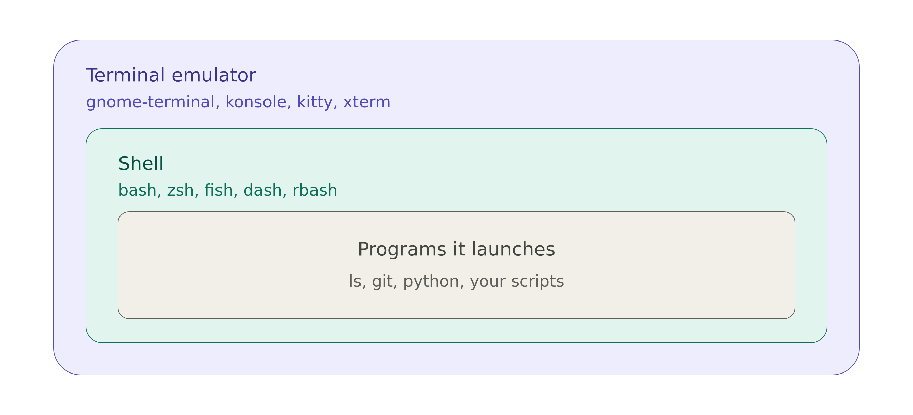

# Terminal Systems

I've always had a confusion on terminals and shell. Now, I want to clarify the related
concepts and resolve the confusion.

## The Outer Layer: Terminal Emulators

The applications on this layer are called terminal emulators, they provide a GUI window
draw texts and forwards keystrokes into whatever program running inside it. Some
terminal emulators are: `gnome-terminal`, `konsole`, `alacritty`, and `xterm`.

## The Middle Layer: The Shell

A shell is a program that read the commands, interpret it, and launches other programs.
Some examples are:

- `bash`: The long-time default on most linux distros. It's a superset of the old POSIX
  `sh` standard. For example, `sh` doesn't support `[[ ... ]]` and `arrays`.
- `dash`: A tiny, fast, strictly POSIX shell. On Debian and Ubuntu, `/bin/sh` points to
  it. It's meant for running scripts quickly, and it's unpleasant to use interactively.
- `rbash`: It's bash in restricted mode. It restricts things like `cd`, changing `PATH`,
  and commands including `/`. Escaping `rbash` limitations are easy, so don't rely on it
  as a real security boundary.
- `zsh`: Similar to `bash` with more features. Default on macOS.
- `fish`: Shell built to be friendly out of the box, with autosuggestions and syntax
  highlighting. It does not strictly support POSIX syntax, so some bash scripts may not
  run it.
